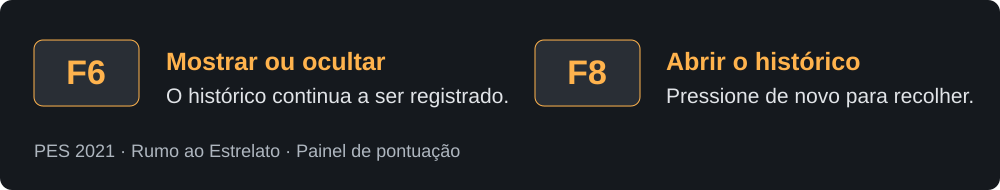

# PES 2021 | Pontuação no Rumo ao Estrelato

O painel mostra a nota do jogador durante as partidas do Rumo ao Estrelato no PES 2021 e registra as mudanças em um histórico que pode ser aberto pelo teclado, sem precisar esperar a tela de resultados para acompanhar a avaliação do jogo.

O projeto funciona no PC como um módulo Lua do Sider, com a configuração testada no PES 2021 versão 1.01.00 e Sider 7.4.1, enquanto o modo Rumo ao Estrelato também aparece com o nome Become a Legend nas versões em inglês.

## Como fica no jogo

O modo compacto reúne os FPS e a nota atual acima da última alteração, ocupando o canto da tela para permitir a consulta durante a partida sem manter o histórico inteiro aberto.


O histórico apresenta uma linha por efeito e mantém a primeira nota identificada no final da lista, como no exemplo `6.0 Nota inicial`, para que as mudanças seguintes possam ser comparadas com o valor de partida.


As imagens foram recortadas das fotos do painel em uso, enquanto a configuração atual usa um fundo um pouco mais escuro e fonte seminegrita, ajustes que entram em uso após abrir novamente o jogo com o Sider.

## Antes de instalar

Para usar o painel, é preciso ter o PES 2021 instalado no Windows e localizar a pasta do Sider, aproveitando a instalação existente caso o jogo já use um patch que inclua esse programa.

A configuração acompanha o jogador de carreira com ID `2147483834`, usado durante o desenvolvimento, por isso outra carreira exige conferir o ID do jogador e validar a leitura antes do uso, já que o painel ainda não oferece seleção automática.

## Instalação passo a passo

### 1. Baixe os arquivos

No início desta página, abra o botão `Code` e escolha `Download ZIP`, depois clique com o botão direito no arquivo baixado e use `Extrair tudo` para acessar a pasta `modules` e o restante do projeto.

### 2. Encontre a pasta do Sider

Localize a pasta que contém `sider.exe` e `sider.ini`, que pode se chamar `Sider` ou `SiderAddons` nos patches, e faça uma cópia do `sider.ini` antes de editá-lo para guardar a configuração que já funciona no seu jogo.

Se o Sider ainda não estiver instalado, baixe a versão 7.4.1 na [página do autor](https://mapote.com/doc/sider/) e extraia os arquivos em uma pasta em que seu usuário possa gravar, como `Documentos\Sider-PES2021`, pois essa dependência não acompanha o projeto.

### 3. Copie o módulo

Com o PES fechado, abra a pasta `modules` do projeto e copie `bal_painel.lua` para a pasta `modules` do Sider, mantendo a organização mostrada abaixo para que o programa encontre o arquivo ao iniciar.

```text
Sider-PES2021/
    sider.exe
    sider.dll
    sider.ini
    modules/
        bal_painel.lua
```

Os arquivos de `study` e as imagens do README podem ficar fora da instalação, enquanto `bal_affinity.lua` e `bal_1610.lua` são módulos opcionais que também não precisam ser ativados para mostrar a nota.

### 4. Configure o sider.ini

Abra `sider.ini` no Bloco de Notas e acrescente a linha abaixo na seção `[sider]`, junto das entradas `lua.module` que já estiverem no arquivo, preservando os módulos usados pelo seu patch.

```ini
lua.module = "bal_painel.lua"
```

Confira as opções abaixo e ajuste as linhas que já existirem, acrescentando somente as que estiverem ausentes para evitar configurações duplicadas, com uma única seção `[sider]` no arquivo.

```ini
lua.enabled = 1
luajit.ext.enabled = 1
match-stats.enabled = 1
overlay.enabled = 1
overlay.on-from-start = 0
overlay.location = "top"
overlay.font = "Segoe UI Semibold"
overlay.font-size = 24
overlay.text-color = "ffb34dff"
overlay.background-color = "0000008d"
overlay.vkey.toggle = 0x75
overlay.block-input-when-on = 0
```

Salve o `sider.ini` depois da edição e abra o jogo novamente com o Sider para carregar a fonte, que fica em tamanho 24 sobre um fundo preto com cerca de 55% de opacidade.

### 5. Confira o caminho do jogo

Se o patch já tem um iniciador que abre o PES com o Sider, mantenha esse iniciador e o caminho configurado pelo autor do patch, usando os exemplos desta etapa apenas quando precisar configurar uma instalação nova.

Para abrir a versão Steam, a seção `[sider]` pode usar as linhas abaixo, que identificam o executável e solicitam a abertura do jogo pela biblioteca da Steam.

```ini
exe.name = "\PES2021.exe"
start.game = "steam://rungameid/1259970"
```

Se a instalação usa um caminho direto, substitua o valor de `start.game` pela localização real do seu executável, usando o exemplo abaixo como referência e mantendo somente uma linha `start.game` no arquivo.

```ini
exe.name = "\PES2021.exe"
start.game = "C:\Games\PES2021\PES2021.exe"
```

### 6. Abra a carreira

Execute `sider.exe` ou o iniciador do patch e entre em uma partida do Rumo ao Estrelato, depois pressione `F6` para mostrar o painel e aguarde a primeira nota válida, já que o campo pode aparecer como `--` antes do cálculo do PES.

A primeira nota vira a referência inicial do histórico, que recebe as alterações seguintes conforme o jogo atualiza a avaliação do jogador, sem acrescentar um aumento fictício ao primeiro valor encontrado.

### 7. Consulte o histórico

Use `F8` para abrir o histórico e pressione a mesma tecla para voltar ao modo compacto, enquanto `F6` mostra ou oculta o painel sem interromper o registro das mudanças durante a partida.



## Como ler as alterações

A nota atual é lida do PES e permanece sob controle do jogo, enquanto o painel usa as capturas para conferir os efeitos das mudanças de estatísticas sem escrever notas ou gols no save.

Uma entrada como `+0,5 Gol` corresponde ao efeito conferido naquele estado da partida, e não a um valor fixo para todo gol, porque a posição do jogador e os limites do cálculo podem permitir o aumento dos pontos internos sem alterar a nota exibida.

O texto `Contexto da partida` agrupa efeitos associados a dados coletivos ou a mudanças que o modelo não separou em uma ação individual, enquanto `Causa nao identificada` informa que a nota mudou sem uma explicação conferida para aquele intervalo.

O sufixo `(contexto fixo)` identifica o método anterior de comparação, que mantém o contexto posterior da partida fixo, e os nomes dos eventos continuam sujeitos à limitação de que ainda não foi validada uma causa exclusiva por ação física para todas as mudanças de nota.

## Se o painel não funcionar

| Situação | O que conferir |
| --- | --- |
| F6 não mostra o painel | Confira se o jogo abriu com o Sider e se `bal_painel.lua` está em `modules` e na lista do `sider.ini`. |
| Aparecem FPS, mas a nota não é encontrada | Confira o ID do jogador e a versão do executável, pois a leitura foi verificada com a configuração indicada no início deste README. |
| O campo da nota continua como `--` | Aguarde o cálculo do PES e, se o problema continuar, confira o ID do jogador e as mensagens do `sider.log`. |
| A fonte continua igual após editar o arquivo | Feche o jogo e abra novamente pelo Sider para carregar a configuração salva no `sider.ini`. |
| Aparece um erro do módulo | Abra `sider.log` na pasta do Sider e procure as mensagens com `bal_painel.lua` ou `lua ERROR` para identificar onde a leitura parou. |

Para desativar o painel, feche o jogo e remova a linha `lua.module = "bal_painel.lua"` do `sider.ini`, preservando as outras entradas para que os módulos do patch continuem disponíveis.

## Código e pesquisa

O código do painel fica em `modules/bal_painel.lua`, com os modelos de cálculo e verificadores separados em `study` para quem quiser acompanhar a pesquisa descrita em [docs/PESQUISA.md](docs/PESQUISA.md), sem precisar desses arquivos para instalar o módulo.

Os registros de partida ficam na pasta local do Sider e não acompanham o repositório, que também não distribui o executável ou os arquivos do PES e não tem vínculo com a Konami.

O Sider foi desenvolvido por Anton Jouline (juce), cuja [documentação](https://mapote.com/doc/sider/sider7/readme.html) descreve a instalação e as opções do programa, enquanto o módulo opcional de proporção de tela mantém os créditos da técnica de Durandil67 e da adaptação de eskay993.
