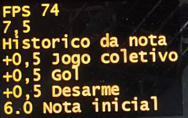
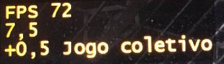

# Painel de nota para PES 2021

Painel para o modo Rumo ao Estrelato do PES 2021 no Windows, desenvolvido como módulo Lua do Sider. A interface mostra os FPS e a nota original do jogador durante a partida, com um histórico das mudanças de nota e dos efeitos que o modelo conseguiu conferir nas capturas do jogo.

## Interface

O modo compacto exibe a nota atual e a última alteração, enquanto o histórico apresenta uma linha por efeito, sem títulos duplicados. A última linha informa a primeira nota identificada na partida, como `6.0 Nota inicial`, e os demais valores usam vírgula decimal na apresentação.





As imagens são recortes das fotografias da versão em uso, restritos à área do painel dentro da tela. Os valores mostrados correspondem à partida fotografada.

## Requisitos e compatibilidade

O módulo foi usado no Windows com PES 2021 versão 1.01.00 e Sider 7.4.1, com LuaJIT e as extensões de memória habilitadas. Os endereços e as assinaturas foram verificados nessa instalação, portanto a compatibilidade com outras versões do executável precisa de validação própria.

A configuração atual acompanha o jogador de carreira com ID `2147483834`. Esse ID pode ser diferente em outro save e deve ser conferido antes de usar o painel em outra carreira. O módulo não oferece uma tela de seleção de jogador.

## Instalação

Instale o Sider a partir da distribuição do autor e copie `modules/bal_painel.lua` para a pasta `modules` dessa instalação. Adicione as opções abaixo ao arquivo `sider.ini`, preservando as configurações dos módulos e patches já instalados.

```ini
[sider]
lua.enabled = 1
luajit.ext.enabled = 1
match-stats.enabled = 1
lua.module = "bal_painel.lua"
overlay.enabled = 1
overlay.on-from-start = 0
overlay.font = "Lucida Console"
overlay.font-size = 24
overlay.location = "top"
overlay.text-color = "ffb34dff"
overlay.background-color = "00000080"
overlay.vkey.toggle = 0x75
overlay.block-input-when-on = 0
```

Abra o PES com o Sider e entre no Rumo ao Estrelato. O painel começa oculto, e a primeira nota aparece quando o PES calcula um valor válido para o jogador.

## Controles

| Tecla | Função |
| --- | --- |
| F6 | Mostrar ou ocultar o painel |
| F8 | Alternar entre o modo compacto e o histórico |
| Shift + R | Recarregar módulos modificados do Sider em uma tela de pausa |

O histórico continua a receber mudanças quando o painel está oculto. A primeira nota constitui o ponto inicial da comparação e não recebe uma variação fictícia.

## Leitura dos resultados

A nota exibida vem diretamente do PES. O modelo usa os dados capturados para conferir os pontos internos e calcular efeitos condicionais nos estados anteriores e posteriores aos eventos nativos, com operações em precisão float32.

Rótulos como `Gol`, `Desarme` e `Jogo coletivo` identificam a classificação usada para o evento observado. Um resultado como `+0,5 Gol` pertence ao estado daquela partida e não estabelece um bônus fixo por gol. Um evento interno pode envolver várias alterações de estatísticas, e a comparação entre jogadores também interfere na nota.

`Contexto da partida` reúne efeitos que o cálculo não separou em uma ação individual. `Causa nao identificada` informa que a mudança da nota foi registrada, mas não houve uma explicação conferida para ela. O sufixo `(contexto fixo)` identifica o caminho anterior de análise condicional, cujo cálculo mantém o contexto posterior fixo.

A atribuição física de uma única ação e a causa histórica exclusiva de cada mudança continuam sem validação completa. As verificações existentes sustentam a leitura da nota e os efeitos condicionais nos casos capturados, com esses limites preservados no código.

## Arquivos do projeto

`modules` contém o painel e dois módulos opcionais. `bal_affinity.lua` aplica afinidade aos processadores de 0 a 11, ajuste específico da máquina usada no desenvolvimento, que deve ser avaliado antes do uso em outro computador. `bal_1610.lua` contém o ajuste opcional de proporção de tela e depende dos recursos de interface disponíveis na instalação local.

`study` contém o código de pesquisa e os verificadores usados durante o desenvolvimento. Esses arquivos ficam separados da instalação do usuário, pois não são necessários para exibir o painel. Os logs reais e os dumps não acompanham o repositório.

## Dados de pesquisa

O módulo pode gerar `sider.log`, `bal-rating-captures.log` e `bal-context-captures.balc` na pasta do Sider. Os dois últimos arquivos preservam dados cumulativos para análise, e o arquivo BALC usa compressão XPRESS_HUFF com conferência SHA256. Esses registros podem crescer durante o uso e devem permanecer fora dos commits.

A ferramenta `study/audit-raw-events.cjs` reprocessa capturas existentes e exporta os efeitos em CSV. Sua execução exige Node.js e PowerShell 7 no Windows. A base contínua exportada vem do modelo antes da quantização da base e não deve ser apresentada como um valor intermediário lido diretamente do executável.

```powershell
node study/audit-raw-events.cjs "C:\Sider\bal-rating-captures.log" "IDENTIFICADOR_DA_SESSAO" "C:\Sider\bal-context-captures.balc"
```

Os ensaios que executam rotinas nativas isoladas precisam dos arquivos locais do jogo e de dependências de desenvolvimento próprias. Eles não constituem um procedimento de instalação do painel.

Os scripts de pesquisa que precisam de arquivos do PES usam `C:\Games\PES2021` como caminho de referência na cópia pública. Ajuste esse caminho para sua instalação antes de executar esses ensaios. Os scripts históricos de integração e empacotamento registram etapas do desenvolvimento e não devem ser usados para reinstalar a versão atual.

## Dependências e distribuição

O Sider é um projeto de Anton Jouline (juce), disponível na [página do autor](https://mapote.com/doc/sider/). Sua [documentação de módulos Lua](https://mapote.com/doc/sider/sider7/scripting.html) descreve a interface usada pelo painel.

Este repositório contém o código do painel e sua documentação. O executável do PES, os arquivos do jogo e os binários do Sider não fazem parte desta cópia pública. Cada dependência mantém as condições de uso e os direitos de seus autores. O projeto não tem vínculo com a Konami.
